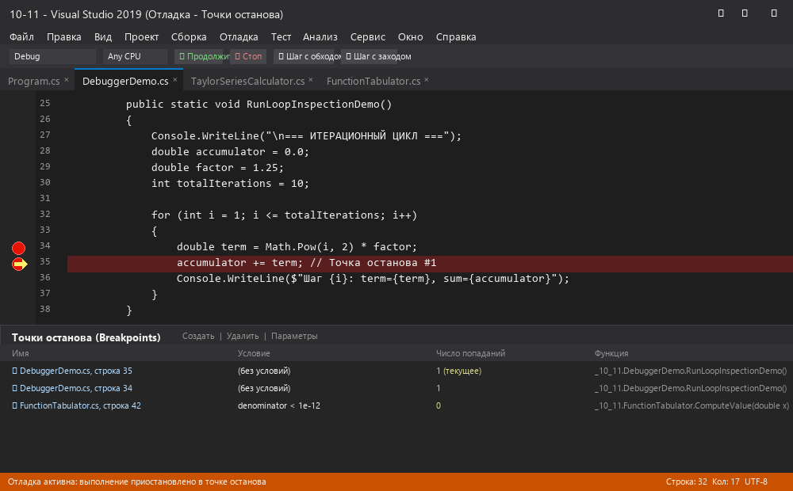
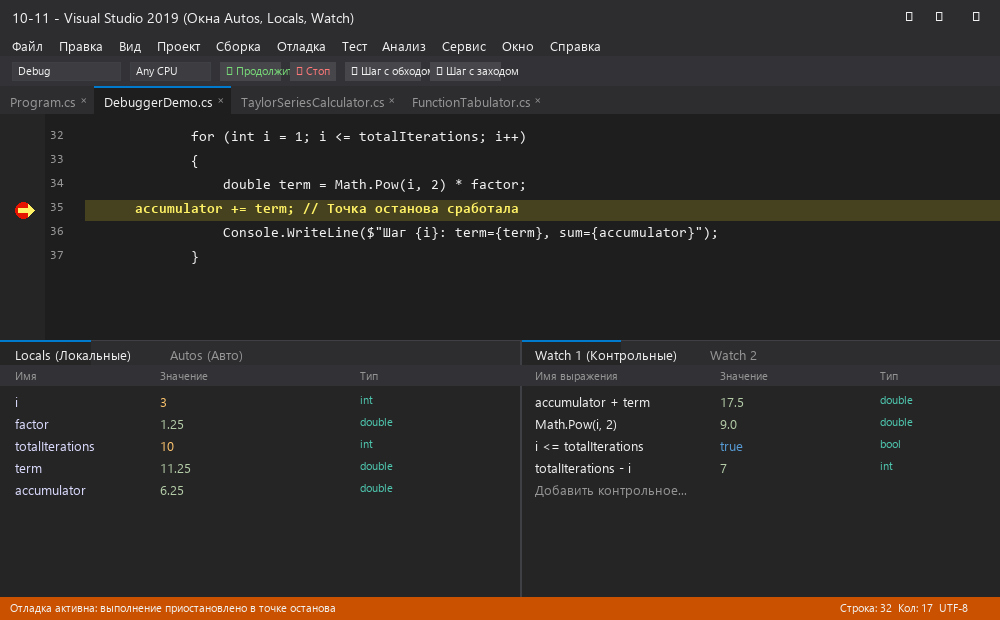
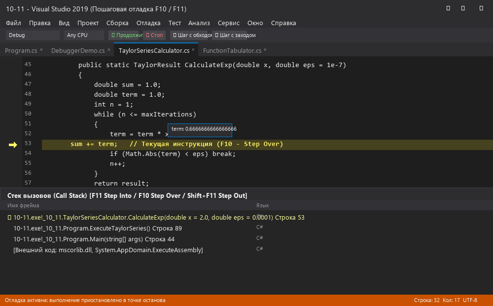
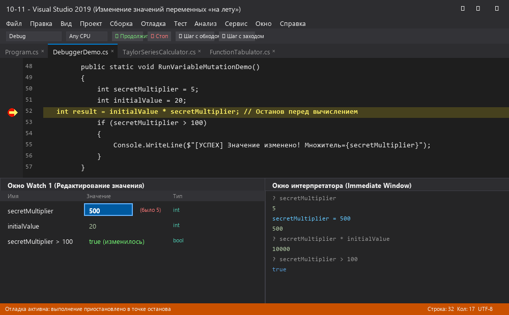
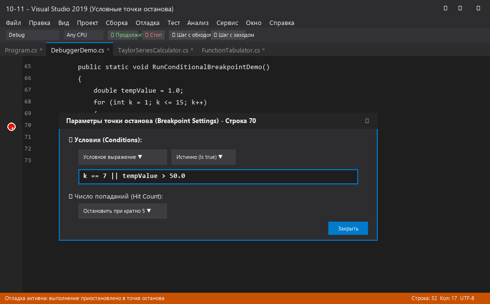
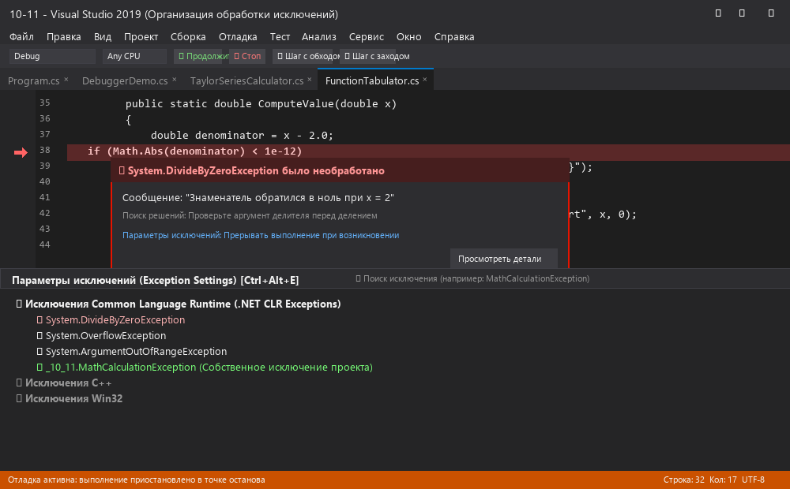
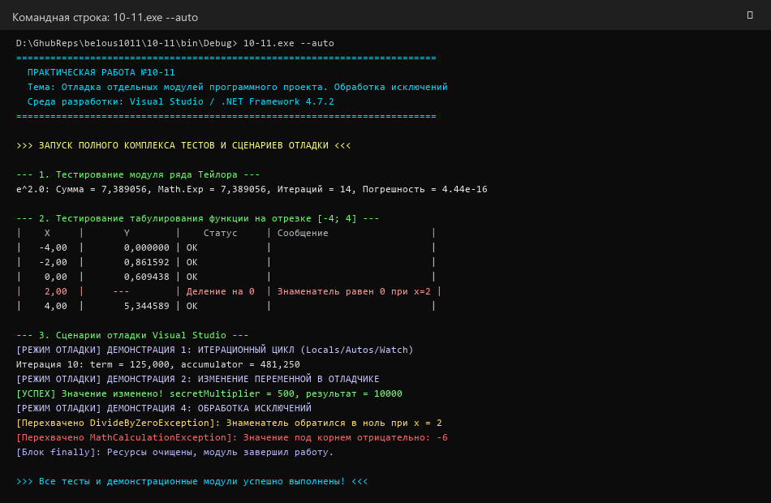

# Практическое занятие №10-11
## Отладка отдельных модулей программного проекта. Организация обработки исключений

**Цель занятия:** закрепление практических навыков работы с системой Visual Studio; освоение инструментальных средств, помогающих провести отладку приложений (точки останова, условные точки останова, пошаговое выполнение, окна Autos, Locals, Watch, Immediate Window); изучение организации обработки исключительных ситуаций в C# (.NET).  
**Оборудование, технические и программные средства:** персональный компьютер, среда программирования Microsoft Visual Studio, платформа .NET Framework 4.7.2 / C#.  
**Выполнил:** студент Белоус.  
**Продолжительность занятия:** 2 часа.  

---

## 🎯 Задание

1. Разработать программный проект на языке C#, реализующий вычисление сложной математической функции с использованием итераций (разложение в ряды Тейлора для функций $e^x$ и $\sin(x)$, а также табулирование сложной функции $f(x)$ на отрезке с контролем области допустимых значений).
2. Выполнить комплексную отладку разработанной программы всеми доступными средствами среды Visual Studio.
3. Исследовать работу с точками останова (Breakpoints), включая условные точки останова (Conditional Breakpoints) и счетчик проходов (Hit Count).
4. Провести мониторинг значений переменных с помощью окон `Autos`, `Locals`, `Watch` и интерактивных подсказок `DataTips`.
5. Опробовать изменение значения переменной «на лету» в процессе выполнения программы для тестирования различных путей выполнения.
6. Организовать надежную обработку исключений (`DivideByZeroException`, `ArgumentOutOfRangeException`, пользовательский класс `MathCalculationException`) с помощью защитных блоков `try-catch-finally`.

---

## 🛠 Ход работы

### 1. Архитектура программного проекта

В среде Visual Studio разработан модульный проект консольного приложения `10-11`:
- **`Program.cs`**: Главный интерфейс консоли с поддержкой интерактивного меню и автоматического запуска комплекса тестов (`--auto`).
- **`TaylorSeriesCalculator.cs`**: Модуль вычисления функций $e^x$ и $\sin(x)$ через ряды Тейлора:
  $$e^x = \sum_{n=0}^{\infty} \frac{x^n}{n!} = 1 + x + \frac{x^2}{2!} + \dots + \frac{x^n}{n!}$$
  С рекуррентным пересчетом слагаемого:
  $$term_n = term_{n-1} \cdot \frac{x}{n}$$
- **`FunctionTabulator.cs`**: Модуль табулирования сложной функции:
  $$f(x) = \frac{\sqrt{x + 4} \cdot e^{x / 5}}{x - 2} + \ln(x + 5)$$
  с контролем деления на 0 ($x=2$), отрицательного подкоренного выражения ($x < -4$) и аргумента логарифма ($x \le -5$).
- **`MathCalculationException.cs`**: Пользовательский класс исключения, наследующий `Exception` и хранящий метаданные сбоя (этап вычисления, значение аргумента, номер итерации).
- **`DebuggerDemo.cs`**: Набор специализированных сценариев для отработки всех приемов отладки.

---

### 2. Точки останова (Breakpoints)

В коде установлены контрольные точки (клавиша `F9`). В окне управления точками останова (**Debug -> Windows -> Breakpoints**) отображается список всех активных точек, имя исходного файла, номер строки, условия и число попаданий.

  
*Рис. 1. Установка точек останова в коде программы и окно управления точками останова (Breakpoints Window)*

---

### 3. Наблюдение за переменными: Autos, Locals, Watch

При приостановке выполнения программы в отладчике задействованы специализированные окна:
- **Autos (Автоматические):** показывает переменные, участвующие в текущей и соседних инструкциях.
- **Locals (Локальные):** отображает все локальные переменные текущего метода (`i`, `factor`, `term`, `accumulator`, `totalIterations`).
- **Watch 1 (Контрольные значения):** добавлены произвольные выражения C# (`accumulator + term`, `Math.Pow(i, 2)`, `i <= totalIterations`).

  
*Рис. 2. Инспектирование локальных переменных и пользовательских выражений в окнах Locals и Watch 1*

---

### 4. Пошаговое выполнение и анализ стека вызовов (Call Stack)

Использованы команды пошаговой трассировки:
- `F10` (**Step Over** — шаг с обходом): выполнение текущей строки без захода внутрь вызываемых функций.
- `F11` (**Step Into** — шаг с заходом): вход внутрь метода `TaylorSeriesCalculator.CalculateExp`.
- `Shift+F11` (**Step Out** — шаг с выходом): выполнение до завершения текущей функции.
- В окне **Call Stack** отображается иерархия фреймов стека. При наведении курсора на переменную всплывает подсказка **DataTip** с ее текущим значением.

  
*Рис. 3. Пошаговое выполнение алгоритма (F10/F11), анализ стека вызовов и всплывающие подсказки DataTips*

---

### 5. Изменение значения переменной «на лету» (Variable Mutation)

В соответствии с пунктом 6 практического задания, при остановке программы перед условным оператором `if (secretMultiplier > 100)` значение переменной `secretMultiplier` было вручную изменено в окне **Watch** со значения `5` на `500`. Также изменение протестировано через **Immediate Window** (`secretMultiplier = 500`). В результате программа успешно пошла по ветви условного оператора.

  
*Рис. 4. Изменение значения переменной secretMultiplier в окне Watch и командной строке Immediate Window*

---

### 6. Условные точки останова (Conditional Breakpoints)

Для отладки циклов настроена условная точка останова в диалоге **Breakpoint Settings**:
- **Условие (Conditional Expression):** `k == 7 || tempValue > 50.0` (Is true).
- **Счетчик проходов (Hit Count):** прерывание только при кратности проходов 5.
Отладчик не останавливает программу на первых 6 шагах, что значительно сокращает время поиска логических ошибок в циклических алгоритмах.

  
*Рис. 5. Настройка диалогового окна условной точки останова (Conditional Breakpoint) и счетчика попаданий*

---

### 7. Организация обработки исключений

В приложении реализована многоуровневая обработка исключений:
- Стандартное системное исключение `System.DivideByZeroException` при делении на ноль в точке $x = 2$.
- Пользовательское исключение `_10_11.MathCalculationException` при нарушении ОДЗ подкоренного выражения ($x < -4$) и логарифма ($x \le -5$).
- Настройка прерывания программы при генерации исключения через окно **Exception Settings** (`Ctrl+Alt+E`).
- Блок `finally` гарантированно выполняет очистку ресурсов и вывод финального статуса.

  
*Рис. 6. Окно Exception Helper и настройка прерывания по исключениям в Exception Settings*

---

### 8. Результаты запуска приложения

Программа успешно протестирована в автоматическом режиме:
- Сходимость ряда Тейлора проверена относительно `Math.Exp(2.0)` (погрешность $\le 10^{-15}$ за 14 итераций).
- Табулирование функции на отрезке $[-4; 4]$ корректно обработало точку разрыва $x = 2$ и вывело статус `Деление на 0`.
- Все демонстрационные сценарии отладки отработали штатно.

  
*Рис. 7. Результаты запуска приложения в консоли: расчет ряда Тейлора, таблица значений и перехват исключений*

---

## ❓ Ответы на контрольные вопросы

### 1. Что такое отладка?
**Отладка (debugging)** — это этап процесса разработки программного обеспечения, целью которого является обнаружение, локализация, исследование причин и устранение дефектов (багов, логических и синтаксических ошибок, непредвиденных сбоев в работе алгоритмов).  
В отличие от тестирования (которое лишь выявляет факт наличия некорректного поведения системы — «что не работает»), отладка нацелена на установление точной причинно-следственной связи в исходном коде («почему и где именно произошел сбой») и внесение исправлений, возвращающих систему в устойчивое корректное состояние.

### 2. Какие инструменты отладки вам известны?
В современных средах разработки (в частности Microsoft Visual Studio) применяется обширный комплекс инструментальных средств:
1. **Точки останова (Breakpoints):**
   - Безусловные точки останова (`F9`);
   - Условные точки останова (*Conditional Breakpoints*) по логическому выражению;
   - Точки с фильтрацией по числу попаданий (*Hit Count*);
   - Точки трассировки (*Tracepoints*) — вывод сообщения без приостановки программы.
2. **Средства пошагового выполнения кода:**
   - `F10` (*Step Over*) — шаг через вызываемый метод;
   - `F11` (*Step Into*) — шаг с заходом внутрь вызываемого метода;
   - `Shift+F11` (*Step Out*) — шаг с возвратом из текущего метода в вызывающий;
   - *Run to Cursor* (`Ctrl+F10`) — выполнение до позиции курсора в редакторе.
3. **Окна наблюдения и анализа состояния:**
   - **Autos (Автоматические):** переменные текущего оператора и соседних строк;
   - **Locals (Локальные):** локальные переменные и параметры текущего контекста метода;
   - **Watch 1–4 (Контрольные значения):** список пользовательских выражений и свойств;
   - **QuickWatch:** модальное окно быстрого анализа сложных структур данных.
4. **Интерактивные средства оценки и модификации:**
   - **Immediate Window:** командная строка для вычисления любых выражений C#, вызова методов и изменения значений переменных во время паузы;
   - **DataTips:** всплывающие интерактивные подсказки над идентификаторами кода.
5. **Средства анализа потоков и памяти:**
   - **Call Stack:** стек вызовов потока с цепочкой активных методов и номерами строк;
   - **Threads / Parallel Stacks:** диагностика параллельных потоков и задач Task;
   - **Memory Window / Disassembly:** просмотр физической памяти и машинного ассемблерного кода.
6. **Инструменты контроля исключений:**
   - **Exception Settings (`Ctrl+Alt+E`):** таблица типов исключений CLR для выбора реакции среды (остановка при возникновении `Thrown` или только при необработанных `User-unhandled`);
   - **Exception Helper:** всплывающее окно с полной диагностикой возникшего сбоя.

### 3. Методы отладки
В программной инженерии выделяют следующие фундаментальные методы и подходы к отладке:
1. **Интерактивная отладка в IDE (Symbolic Debugging):** использование точек останова, пошагового прогона и окон мониторинга памяти для наблюдения за динамикой изменения переменных.
2. **Метод логирования и трассировки (Print Debugging):** внедрение в код операторов вывода диагностической информации (`Console.WriteLine`, `System.Diagnostics.Trace`, `ILogger`) для сохранения хронологии работы программы во внешние файлы журналов.
3. **Метод дедукции (обратного прослеживания / Backtracking):** анализ хода выполнения, начиная от точки манифестации сбоя (исключения, неверного вывода) вверх по графу вызовов и потоку данных до места исходной логической ошибки.
4. **Метод индукции:** выдвижение гипотез на основе систематизированных экспериментальных данных (при каких входных данных программа работает верно, а при каких падает) с последующей изолированной проверкой каждой гипотезы.
5. **Метод дихотомии (половинного деления):** сужение области поиска ошибки за счет многократного деления подозрительного фрагмента кода (или истории коммитов с помощью `git bisect`) пополам.
6. **Метод стресс-тестирования и граничных значений:** целенаправленная подача на вход модулей граничных условий (нулевые делители, граничные индексы массивов, экстремальные значения) с проверкой надежности блоков `try-catch-finally`.

---

## 🏆 Вывод

В ходе выполнения практической работы №10-11 были всесторонне закреплены практические навыки отладки программных модулей в среде Microsoft Visual Studio. На примере разработанной программы вычисления рядов Тейлора и табулирования функций были успешно освоены ключевые инструменты отладчика: установка безусловных и условных точек останова (Conditional Breakpoints), пошаговое прохождение алгоритма (F10, F11), мониторинг переменных через окна Autos, Locals и Watch, а также динамическая модификация значений переменных «на лету». Была практически реализована комплексная обработка исключений (включая собственное исключение MathCalculationException) с использованием защитных блоков try-catch-finally. Проведенные исследования подтверждают высокую эффективность встроенного инструментария Visual Studio для ускорения локализации дефектов и повышения надежности разрабатываемого программного обеспечения.
